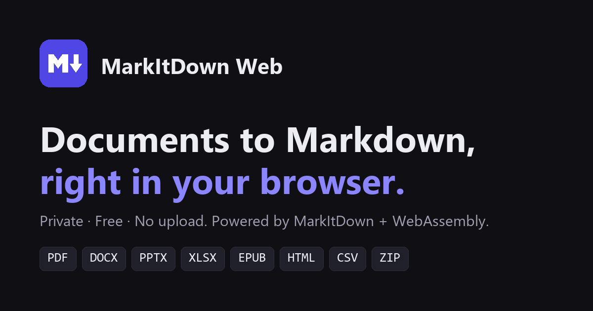

# MarkItDown Web

[](https://github.com/jwlei/markitdownweb/actions/workflows/pages.yml)
[](LICENSE)

**Convert PDF, Word, PowerPoint, Excel and more to Markdown, right in your browser.**

👉 **[jwlei.github.io/markitdownweb](https://jwlei.github.io/markitdownweb/)**

MarkItDown Web runs Microsoft's [MarkItDown](https://github.com/microsoft/markitdown) entirely client-side with [Pyodide](https://pyodide.org) (CPython compiled to WebAssembly). There's no server, so files are read locally and never uploaded. The output is clean Markdown ready for LLMs, RAG pipelines and text analysis.



## Features

- **Private by design.** Conversion happens in a Web Worker in your browser. Nothing leaves your device.
- **Free and static.** Hosted on GitHub Pages with no backend, accounts or limits.
- **Batch conversion.** Drop several files at once, then copy the results or download each as `.md`.
- **Fast repeat visits.** The first visit downloads the Python runtime and libraries (about 30 MB); after that your browser serves them from cache.

## Supported formats

| Format | Notes |
| --- | --- |
| PDF | Text, headings and tables (pdfminer + pdfplumber) |
| Word `.docx` | Headings, lists, tables, OMML equations as LaTeX |
| PowerPoint `.pptx` | Slides, tables, charts, speaker notes |
| Excel `.xlsx`, `.xls` | Each sheet as a Markdown table |
| Outlook `.msg` | Headers and body |
| EPUB | Metadata and chapters |
| HTML | Including Wikipedia and Bing SERP pages |
| CSV, JSON, XML, text | Encoding is auto-detected |
| RSS / Atom | Feed items as sections |
| Jupyter `.ipynb` | Markdown and code cells |
| ZIP | Converts every supported file inside |

**Not available in the browser:** image OCR and EXIF metadata (requires `exiftool`), audio transcription, YouTube transcripts, and Azure Document Intelligence / Content Understanding. Use the [Python package](packages/markitdown/README.md) for those.

## How it works

```
index.html + app.js ──postMessage──▶ worker.js (Web Worker)
                                       │
                                       ├─ loads Pyodide 0.29.5 (Python 3.13) from jsDelivr
                                       ├─ micropip installs pure-Python + Pyodide-built deps
                                       └─ installs the markitdown wheel built from this repo
                                                │
                                         markitdown_web.py
                                         convert(filename, bytes) → Markdown
```

[`web/markitdown_web.py`](web/markitdown_web.py) is the bridge between JavaScript and MarkItDown. It also stubs out two dependencies that cannot run in WebAssembly, so the Python package itself needs no changes:

- **`magika`** needs onnxruntime, which has no WebAssembly build. MarkItDown falls back to detecting file types by extension.
- **`pypdfium2`** is only used by pdfplumber to render pages as images, which MarkItDown never does, and its native build crashes Pyodide. pdfplumber's table extraction still works.

Pyodide is pinned to 0.29.5 because `cryptography` (needed by pdfminer) aborts the runtime on import in the 314.x line.

## Development

Requires Python 3.10+.

```bash
python web/build.py              # builds the wheel and assembles _site/
python -m http.server -d _site   # open http://localhost:8000
```

`web/build.py` builds `packages/markitdown` into a wheel, copies the files from `web/` next to it, and writes `wheel.json` so the worker knows the wheel's filename.

The Python library and its tests live in [`packages/markitdown`](packages/markitdown). Run its tests with `cd packages/markitdown && hatch test`.

## Deployment

Every push to `main` runs [`.github/workflows/pages.yml`](.github/workflows/pages.yml), which builds the site and deploys it to GitHub Pages.

One-time setup: in the repository's **Settings → Pages**, set **Source** to **GitHub Actions**.

## Repository layout

```
web/                    Static front end and the Pyodide bridge
  index.html            Page, styles and SEO metadata
  app.js                UI: file picking, drag and drop, results
  worker.js             Loads Pyodide and runs conversions off the main thread
  markitdown_web.py     Installs dependencies, stubs, convert()
  build.py              Assembles _site/ for GitHub Pages
packages/markitdown/    The MarkItDown Python library (from upstream)
```

## Credits and license

Built on [microsoft/markitdown](https://github.com/microsoft/markitdown) and [Pyodide](https://pyodide.org). MIT licensed; see [LICENSE](LICENSE). MarkItDown is © Microsoft Corporation.
